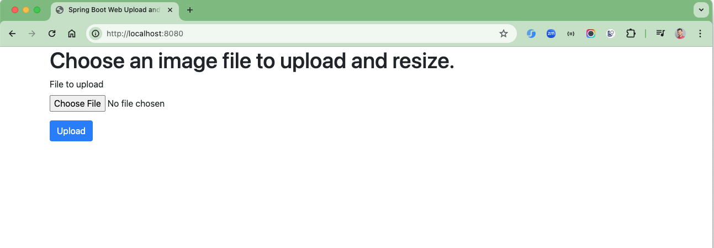
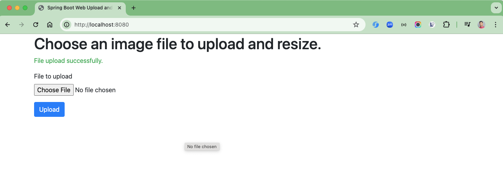
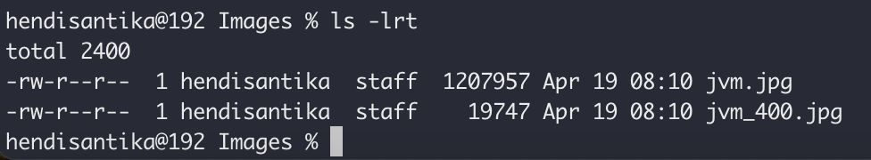

# spring-boot-upload-resize

[](https://github.com/hendisantika/spring-boot-upload-resize/actions/workflows/gradle.yml)
[](https://github.com/hendisantika/spring-boot-upload-resize/actions/workflows/trivy-scheduled.yml)
[](https://github.com/hendisantika/spring-boot-upload-resize/actions/workflows/docker-publish.yml)


Simple Spring Boot web application to **upload an image and resize it automatically** using
[imgscalr](https://github.com/rkalla/imgscalr). The original file and the resized copy
(`<name>_<size>.<ext>`) are stored in a configurable folder.

## Tech Stack

| Component       | Version |
|-----------------|---------|
| Java (JDK)      | 25      |
| Spring Boot     | 4.1.2   |
| Gradle (Wrapper)| 9.9.1   |
| Thymeleaf       | managed by Spring Boot |
| imgscalr-lib    | 4.2     |
| commons-io      | 2.22.0  |

## Prerequisites

- JDK 25 (the build uses a Gradle Java toolchain, so Gradle will pick up a locally installed JDK 25)
- No Gradle installation needed — use the bundled wrapper `./gradlew`

## Configuration

Edit `src/main/resources/application.properties`:

```properties
spring.servlet.multipart.max-file-size=16MB
spring.servlet.multipart.max-request-size=16MB
# Folder where original & resized images are stored (created automatically if missing).
# Defaults to ~/Images, override with the IMAGE_FOLDER environment variable.
image.folder=${IMAGE_FOLDER:${user.home}/Images}
# Target size (px) of the resized image
image.size=400
```

## Health Check

[Spring Boot Actuator](https://docs.spring.io/spring-boot/reference/actuator/endpoints.html) exposes **only** the
health endpoint (other actuator endpoints are not exposed):

| Endpoint                     | Description                                                      |
|------------------------------|------------------------------------------------------------------|
| `/actuator/health`           | Overall status (disk space, image folder, liveness, readiness)   |
| `/actuator/health/liveness`  | Liveness probe – is the app running?                             |
| `/actuator/health/readiness` | Readiness probe – app ready **and** image folder writable        |

A custom `imageFolder` health indicator reports `DOWN` when `image.folder` cannot be created or is not writable.
Component details are hidden (`show-details=never`) so no file system paths are leaked.

```shell
curl http://localhost:8080/actuator/health
```

## Things todo list

1. Clone this repository: `git clone https://github.com/hendisantika/spring-boot-upload-resize.git`
2. Navigate to the folder: `cd spring-boot-upload-resize`
3. (Optional) Choose where images are stored: `export IMAGE_FOLDER=/path/to/your/Images` (default: `~/Images`)
4. Run the application: `./gradlew bootRun`
5. Open your favorite browser: http://localhost:8080

Other useful commands:

```shell
./gradlew build        # compile, run tests and build the jar
./gradlew test         # run tests only
java -jar build/libs/spring-boot-upload-resize-1.0.0.jar
```

## Run with Docker

The project ships with a multi-stage `Dockerfile` (Temurin JDK 25 build → JRE 25 runtime, layered jar, non-root user)
and a `docker-compose.yml`.

```shell
docker compose up -d --build   # build image & start the app on http://localhost:8080
docker compose logs -f app     # follow logs
docker compose down            # stop (add -v to also delete the stored images volume)
```

Uploaded & resized images are stored in the named volume `images` (mounted at `/app/images`).
Both the image (`HEALTHCHECK`) and `docker-compose.yml` (`healthcheck`) use the actuator health endpoint, so
`docker compose ps` shows the container as `healthy` once the app is ready.
The following variables can be set in the shell or in a `.env` file:

| Variable        | Default | Description                       |
|-----------------|---------|-----------------------------------|
| `APP_PORT`      | `8080`  | Host port mapped to the container |
| `IMAGE_SIZE`    | `400`   | Target size (px) of resized image |
| `MAX_FILE_SIZE` | `16MB`  | Max upload file/request size      |

Without Compose:

```shell
docker build -t spring-boot-upload-resize .
docker run -p 8080:8080 -v upload-images:/app/images -e IMAGE_SIZE=300 spring-boot-upload-resize
```

### Pre-built image from GHCR

Images are published to [GitHub Container Registry](https://github.com/hendisantika/spring-boot-upload-resize/pkgs/container/spring-boot-upload-resize)
for `linux/amd64` and `linux/arm64`:

```shell
docker pull ghcr.io/hendisantika/spring-boot-upload-resize:latest   # or a release, e.g. :1.0.0
docker run -p 8080:8080 -v upload-images:/app/images ghcr.io/hendisantika/spring-boot-upload-resize:latest
```

| Tag                  | Published when                         |
|----------------------|----------------------------------------|
| `latest`, `main`     | every push to `main`                   |
| `sha-<short-sha>`    | every published build                  |
| `1.2.3`, `1.2`, `1`  | pushing a git tag `v1.2.3`             |

## CI/CD & Dependency Updates

- **GitHub Actions** (`.github/workflows/gradle.yml`) builds and tests the project with Temurin JDK 25 on every
  push and pull request to `main`, builds the Docker image, validates `docker-compose.yml`, and submits the
  dependency graph for Dependabot alerts.
- **Trivy vulnerability scan** of the Docker image:
  - in CI (`gradle.yml`, job `docker`): the freshly built image is scanned; the build **fails on fixable
    HIGH/CRITICAL** vulnerabilities, and all findings are uploaded as SARIF to the repository **Security → Code
    scanning** tab (category `trivy-ci`).
  - weekly (`trivy-scheduled.yml`, Monday 05:00 Asia/Jakarta, or manual with a custom tag): re-scans the published
    `ghcr.io` image so newly disclosed CVEs are reported (category `trivy-ghcr`).
  - `aquasecurity/trivy-action` is pinned to a commit SHA for supply-chain safety.

  Scan locally: `docker run --rm -v /var/run/docker.sock:/var/run/docker.sock aquasec/trivy image --severity HIGH,CRITICAL ghcr.io/hendisantika/spring-boot-upload-resize:latest`
- **Publish Docker image** (`.github/workflows/docker-publish.yml`) builds a multi-arch image with Buildx and pushes
  it to GHCR on pushes to `main`, `v*.*.*` tags or manual dispatch (pull requests only build, never push). Each pushed
  image gets a signed build provenance attestation.
- **Dependabot** (`.github/dependabot.yml`):
  - Gradle dependencies: checked daily at 05:00 Asia/Jakarta, grouped (Spring Boot, Gradle Wrapper,
    minor & patch), with a cooldown period before new releases are proposed.
  - GitHub Actions & Docker base images: checked weekly and grouped into a single PR per ecosystem.
  - PRs are labeled (`dependencies`, `java`, `gradle`, `github_actions`, `docker`) and use conventional commit prefixes
    (`chore(deps)`, `ci(deps)`, `build(deps)`).

## Image Screenshots

Upload Image Page





Image Has Been resized


